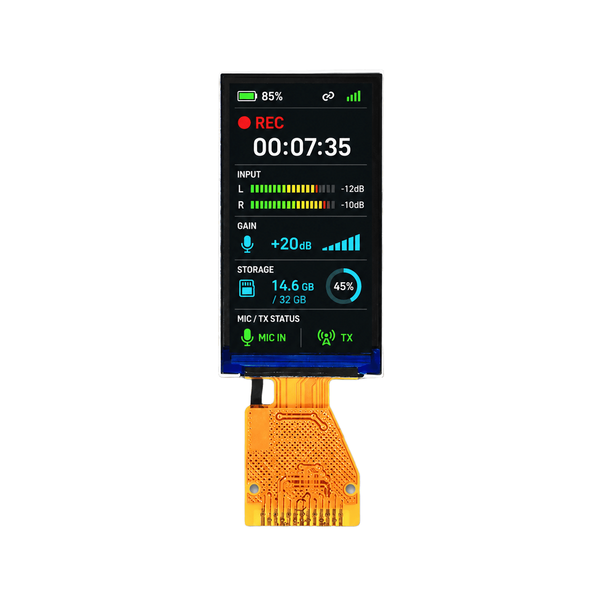

<p align="left"></p>

<h1 align="center">OSPTEK 1.14″ TFT Display 135×240 (YDP114H004-V2)</h1>

<p align="center"><b>TFT module · SPI · ST7789V</b></p>

<p align="center"><a href="./README.md">简体中文</a> | English · <a href="../../README_EN.md">Family index</a></p>

<p align="center">
  
  
</p>

<p align="center"></p>

## Contents

- [Specifications](#specifications)
- [Resources](#resources)
- [Repository layout](#repository-layout)
- [Buy](#buy)
- [Support](#support)

---

## Specifications

| Item | Spec |
| ---- | ---- |
| Size | 1.14 inch |
| Type | TFT |
| Resolution | 135×240 |
| Outline | 17.6 x 31.0 x 1.6 mm |
| Active area | 14.864 x 24.912 mm |
| Interface | SPI |
| Driver IC | ST7789V |
| Touch IC | — |

> Full outline, FPC definition, power, and timing follow the product datasheet / driver IC datasheet.

## Resources

| Category | File |
| ---- | ---- |
| Datasheet | [`ST7789V2_SPEC_V1.0.pdf`](./datasheets/ST7789V2_SPEC_V1.0.pdf) |
| Datasheet | [`YDP114H004-V2.pdf`](./datasheets/YDP114H004-V2.pdf) |

## Repository layout

```text
display-tft-1.14inch-135x240/ # repo root (nav: ../../README_EN.md; sample projects under root examples/)
└── versions/
    └── YDP114H004-V2/        # full materials for this part number
        ├── README.md
        ├── README_EN.md
        ├── osptek.yml
        ├── images/
        └── datasheets/       # product datasheet + driver/touch IC datasheets
```

## Buy

See the [repo home page](../../README_EN.md#where-to-buy).

## Support

See the [repo home page](../../README_EN.md#support).

---

<p align="center"><sub>© 2026 OSPTEK · Materials in this repository are licensed under CC BY 4.0</sub></p>
